# DPPL Sales & Order Tracker — User Guide

**Devendran Plastic Pvt. Ltd.** · Flexible packaging · Version 1.0 (November 2026)

Live app: <https://devendranplastic.github.io/dppl-sales-tracker/>

The app opens in the phone or desktop browser. On a phone, use the browser's **Add to Home screen** option to get the DPPL icon. Amounts are shown in ₹ (Indian format) and dates as DD/MM/YYYY.

---

## 1. Getting started

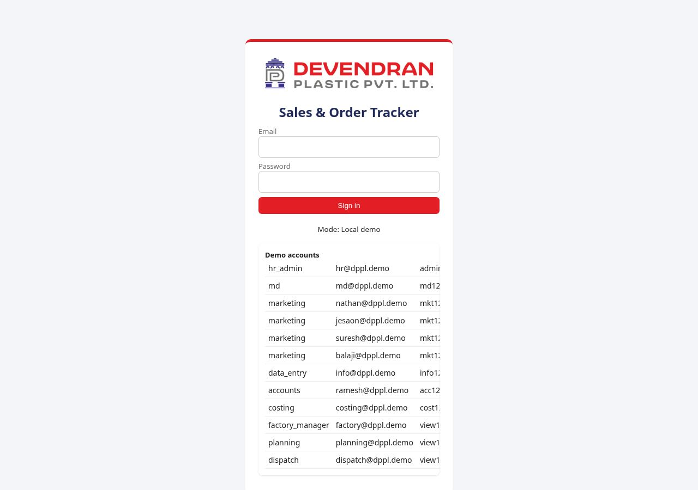

1. Open the live link and sign in with your **@devendranplastic.com** email and the default password HR Admin gave you.
2. **The first time you sign in, the app makes you set a new password** (at least 8 characters, with letters and numbers). After that, use the new password.
3. The menu bar shows only the screens your role is allowed to use. The **🔔 bell** shows messages from the MD or HR Admin.
4. Use **Logout** (top right) on shared computers.

> **Live since 9 November 2026.** The live site uses the real company database: sign in only with your @devendranplastic.com account. (A local demo mode with sample logins exists for training copies where `USE_SUPABASE` is false; header shows *Local demo* there. Demo logins do **not** work on the live site.)

### Who's who

| Person | Login | Role |
|---|---|---|
| HR Admin | hr@devendranplastic.com | HR Admin (super admin) |
| MD | md@devendranplastic.com | MD |
| Balaji | balaji@devendranplastic.com | Marketing |
| Nathan, Jesaon, Suresh | nathan@ / jesaon@ / suresh@devendranplastic.com | Marketing |
| Office data entry | info@devendranplastic.com | Data entry for Balaji |
| Ramesh | accounts@devendranplastic.com | Accounts |
| Costing, Planning, Factory, Dispatch | added by HR Admin in Setup › Users | Department roles |

### What each role can do

| Area | HR Admin | MD / CEO | Marketing | info@ delegate | Accounts | Costing | Planning | Factory | Dispatch |
|---|---|---|---|---|---|---|---|---|---|
| Dashboard and sales-vs-target charts | All | All | Own | — | — | — | — | — | — |
| Enquiries, visits, follow-ups | All | All | Own | For Balaji | View | View | View | View | View |
| Costing and margins | Edit | Edit | Hidden | Hidden | Hidden | Edit | Hidden | Hidden | Hidden |
| Quotations and approval | Approve | Approve | Create | — | — | — | — | — | — |
| Orders and release | Release | Release | Create | — | Credit approval | — | Stages | Stages | Stages |
| Dispatch plan | Edit and confirm | View | View | — | View | — | Edit | — | Confirm |
| Collections, invoices, credit | Edit | View | Own view | — | **Edit** | — | — | — | — |
| ERP sales upload | Upload | View | Own | — | View all | — | — | — | — |
| Setup (users, targets) | Edit | View | — | — | — | — | — | — | — |
| Broadcast messages | Send | Send | Receive | Receive | Receive | Receive | Receive | Receive | Receive |

---

## 2. HR Admin (hr@)

HR Admin is the super admin. This role controls users, master data and imports.

**Setup › Users**

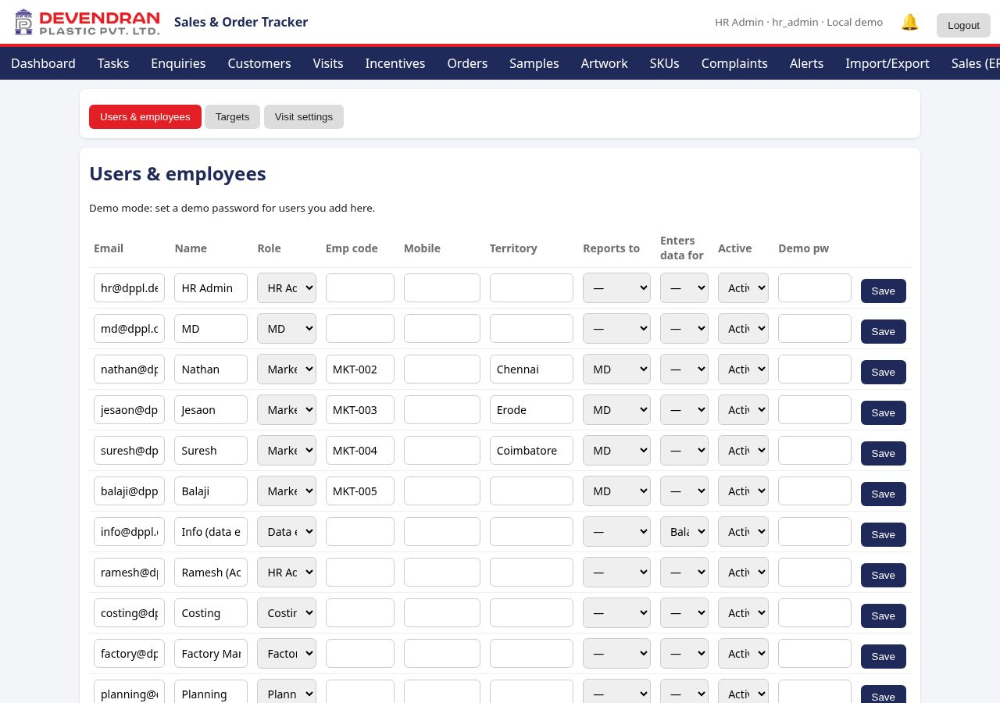

- **Add user:** enter email, name, role and reporting manager. New users must change their password at first sign-in. In live mode, use **Invite** (if the invite-user function is deployed) or create the user in Supabase Auth.
- **Enters data for:** used only with the *Data entry* role. Choose the marketing person whose records this user types in. info@ is set to *Balaji*.
- **Deactivate** a user who leaves. Do not delete them: their history stays and they can no longer sign in.

**Setup › Targets:** add a monthly (or quarterly) sales-value target per marketing person (period YYYY-MM). The MD charts use these targets.

**Setup › Visit settings:** minimum visits per day, Sunday and holiday rules, and visit purposes.

**Import/Export › HR import:** load customers, SKU details, previous order history and the **monthly ERP sales CSV**. When you upload the sales file, map each ERP salesman name to a marketing person, or to **Common sales order** for house accounts. The mapping is remembered for later months.

**Actual cost:** enter the actual cost per kg per SKU each month. Incentives use the latest actual margin.

**Audit log:** shows every change, with the user who made it. A record typed by info@ shows *info@* here even though Balaji owns it.

**Messages:** use the bell › *New message* to send a notice to everyone or to selected roles.

**Monthly routine (first working day):** upload the previous month's ERP sales CSV › check the alias mapping › set targets for the new month › enter actual costs › review Incentives › deactivate leavers.

---

## 3. MD (md@) and CEO

The MD sees everything, including costing, margins and incentives. The CEO role has the same access and can be given to a user in Setup › Users when needed.

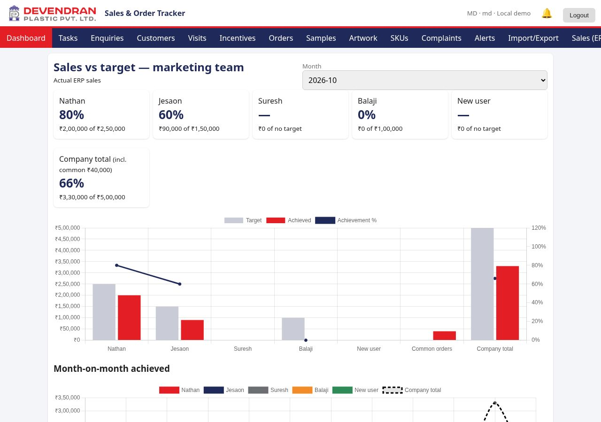

**Dashboard — Sales vs target:** cards for each marketing person (achieved ÷ target %), plus a **Company total** that includes common sales orders. Use the **Month** selector to look at any month. The bar chart shows target vs achieved, with achievement % as a line.

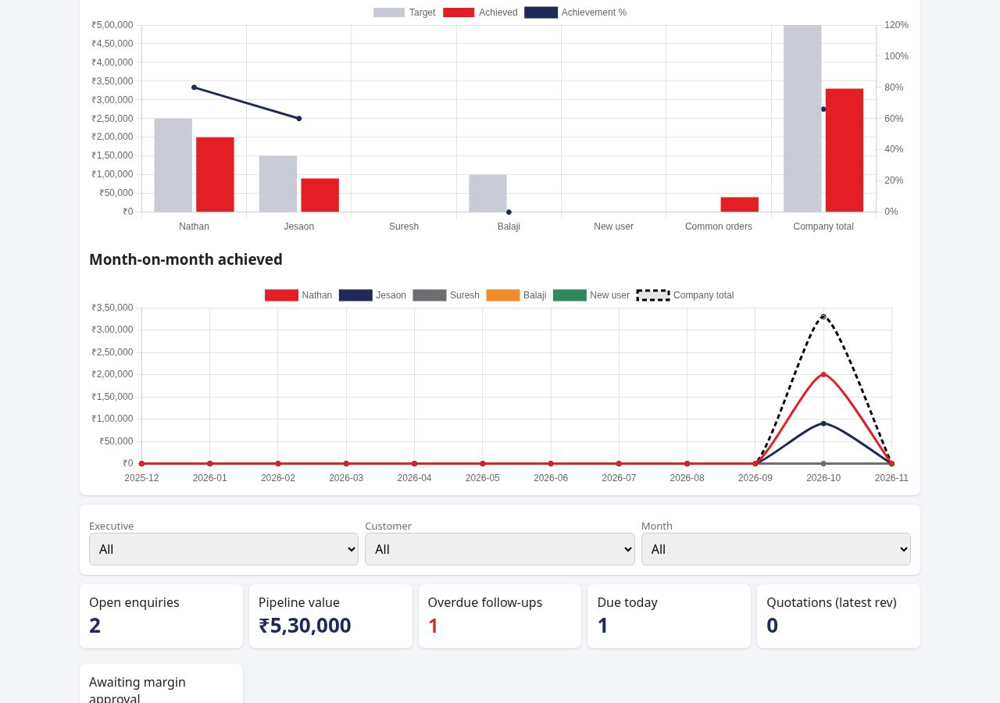

The **Month-on-month** line chart shows the last 12 months for each person and for the company. *Achieved* means actual ERP sales when that month's CSV has been uploaded. Before that, it uses released orders and won enquiries (the chart caption tells you which).

Other MD tasks:

- **Approve quotations** that fall below the minimum margin, or that were sent without a costing sheet (Enquiries › open › *Approve*).
- **Release orders** after the checklist is green (artwork approved, PO, credit OK).
- **Lock artwork** after the customer approves it.
- Review **Alerts** (overdue follow-ups, stuck orders, missed dispatch) and **Collections** (overdue invoices).
- Send **broadcast messages** to the team.

**Daily routine:** dashboard › Alerts › approvals waiting › today's dispatch plan.
**Monthly routine:** check sales vs target for the closed month › Incentives › expense review (when the module is ready).

---

## 4. Marketing (Nathan, Jesaon, Suresh, Balaji)

Each marketing person sees **only their own** customers, enquiries, chart and incentives.

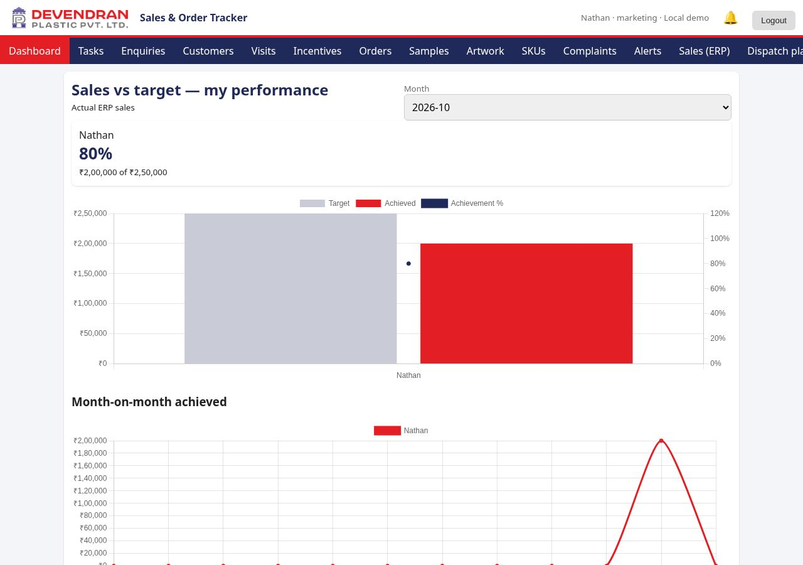

- **Visits:** log every customer visit the same day: customer, new or existing, purpose, discussion, next action. The day's minimum visit count is checked.
- **Enquiries:** create an enquiry (product, size, quantity, due date, next action). The app gives it a number (ENQ-…). Then add the spec, ask Costing for a sheet, and create the **quotation**. A quote below the minimum margin, or without costing, goes to the MD for approval.
- **Tasks:** your follow-ups due today and overdue.
- **Samples / Artwork / Orders:** raise samples, upload artwork for approval, and convert won enquiries into orders with the PO copy.
- **Complaints:** record customer complaints. The factory resolves them.
- **Collections:** view your customers' outstanding invoices so you can follow up on payment.
- **Incentives:** your slab-based incentive on actual ERP sales.

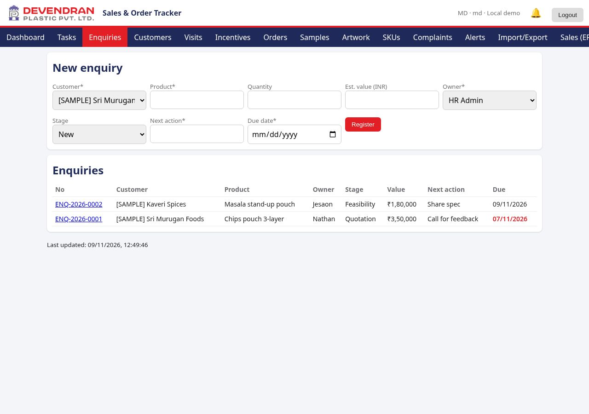

**Daily routine:** morning: Tasks (due follow-ups) › visits › evening: log the day's visits and update enquiries.
**Monthly routine:** check your sales vs target and your incentive after the ERP upload.

---

## 5. info@ — data entry for Balaji

info@devendranplastic.com enters Balaji's visits, enquiries and follow-ups from the reports he sends.

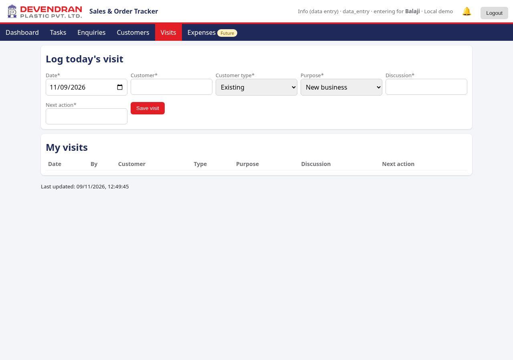

- The header shows **"entering for Balaji"**. Every record you save is **owned by Balaji**: it appears in his lists, chart and incentives.
- The owner drop-down shows only Balaji.
- You cannot see costing, margins or quotations.
- The audit log records **info@** as the person who typed the entry, so HR Admin and the MD can always tell who keyed it.

**Daily routine:** collect Balaji's visit notes (WhatsApp or call) › enter each visit › create or update enquiries and next-action dates › tell Balaji about anything due tomorrow.

---

## 6. Accounts — Ramesh (accounts@)

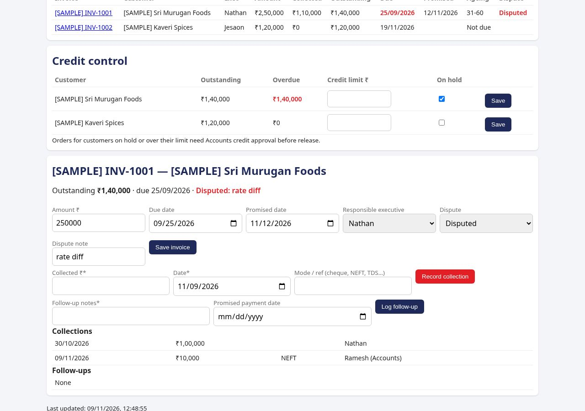

Accounts owns invoice balances and receipts.

- **Collections › Add invoice:** customer, invoice no., amount, due date and executive.
- **Edit invoice:** change the amount, due date or promised date, or mark it **Disputed** with a note.
- **Receipts:** record full or **partial** payments (amount, NEFT or cheque reference). The balance updates.
- **Credit control:** set a **credit limit** and **credit hold** per customer. An order for a customer on hold, or over the limit, cannot be released until Accounts presses **Approve credit** on that order.
- **View only:** ERP sales (all executives), dispatch plan and dispatch invoice copies.
- Costing and margins are hidden. Everything else is read-only.

**Daily routine:** post yesterday's receipts › update promised dates › check orders waiting for credit approval.
**Monthly routine:** review overdue invoices and disputes with the MD › revise credit limits.

---

## 7. Costing (costing@)

- Open enquiries waiting for costing and fill in the **costing sheet**: material layers, gsm, wastage, conversion and freight. The app calculates cost per kg and margin.
- Enter the **Actual cost** per SKU each month. Incentives use it.
- Only Costing, HR Admin and the MD see margins.

**Daily:** clear the costing queue. **Monthly:** enter actual costs after closing.

---

## 8. Planning (planning@)

- **Dispatch plan:** add tomorrow's plan (order, quantity, date, vehicle).
- Update **order stages** for your department (printing, lamination, slitting, pouching).

**Daily (evening):** publish the next day's dispatch plan and update stages.

---

## 9. Factory (factory@)

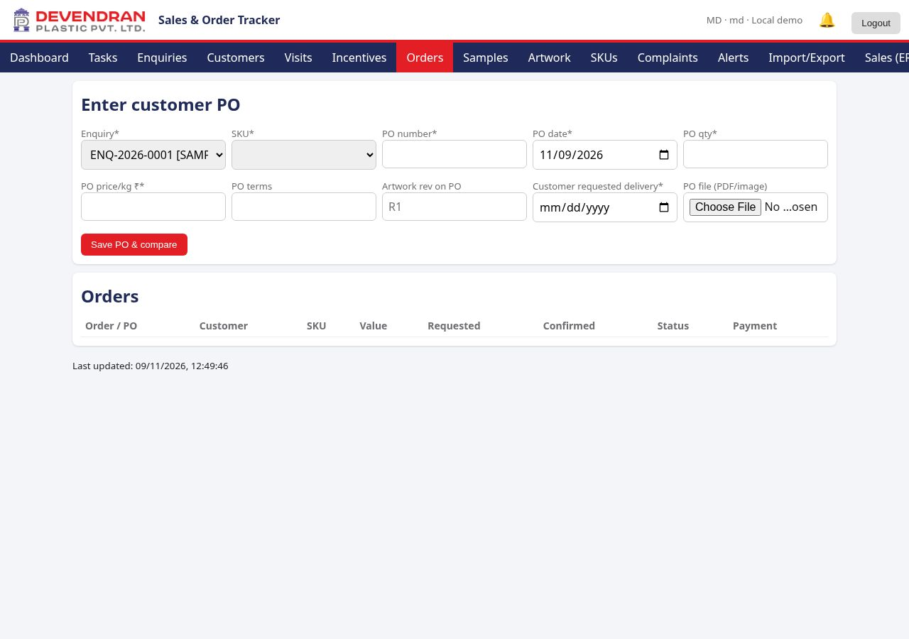

- Update order **production stages**, raise **samples** and **resolve complaints** with the root cause and action taken.

**Daily:** update the stage of every running order before the shift ends.

---

## 10. Dispatch (dispatch@)

- **Dispatch plan › Confirm:** for each planned line, enter the dispatched quantity (full or partial), the **vehicle number** and the invoice no., and upload the invoice copy.
- Lines that are not confirmed by the end of the day show as **Missed** on the MD dashboard.

**Daily:** confirm every dispatch as soon as the vehicle leaves.

---

## 11. Expenses (coming soon)

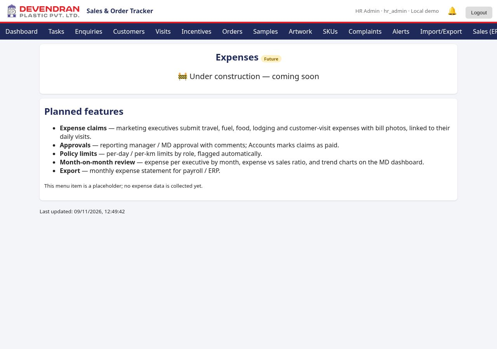

The **Expenses** menu (marked *Future*) is a placeholder. The planned features are expense claims with bill photos, manager and MD approval, policy limits, a **month-on-month expense review** and an export for payroll.

---

## 12. Mobile use

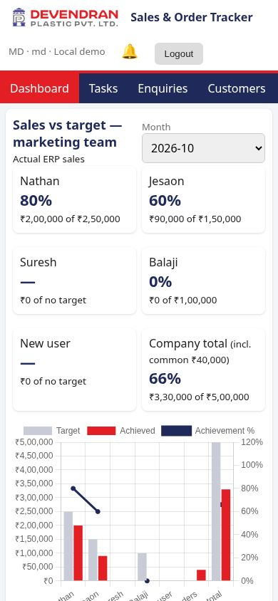

The app works on phones: the menu scrolls sideways, cards stack in two columns, and forms in one. Add it to your home screen for one-tap access.

## 13. Help and safety

- Messages to customers are never sent automatically. The WhatsApp and email buttons only open your own app with the text filled in.
- Forgot your password? Ask HR Admin to reset it in Supabase. You will be asked to change it again at sign-in.
- Problems: contact HR Admin (hr@devendranplastic.com).
